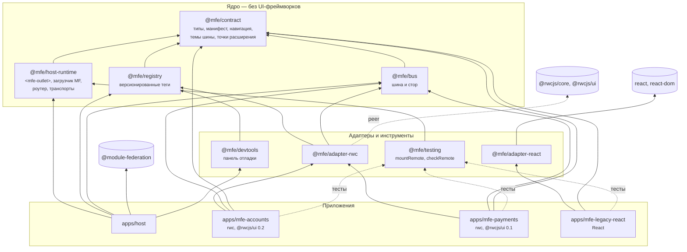
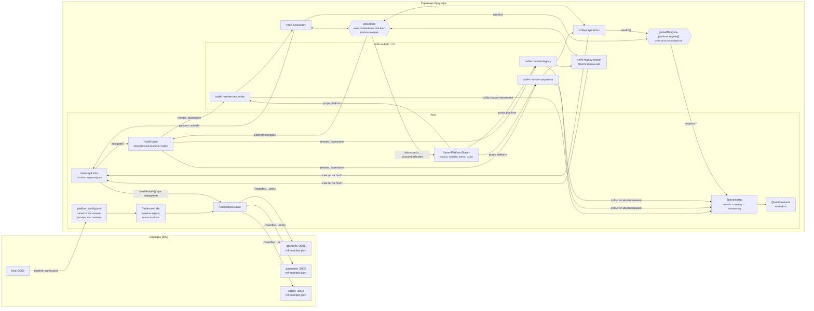
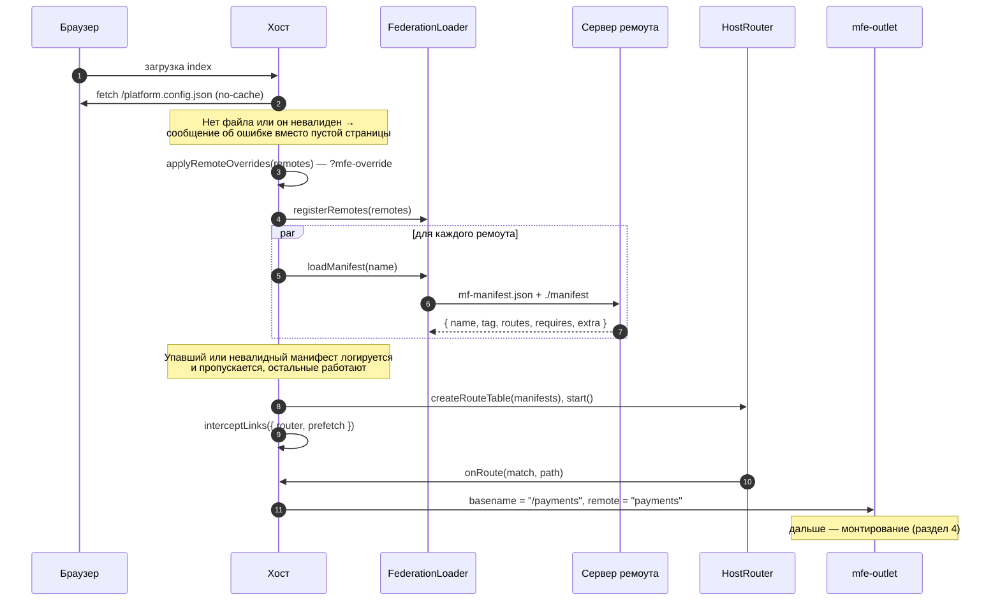
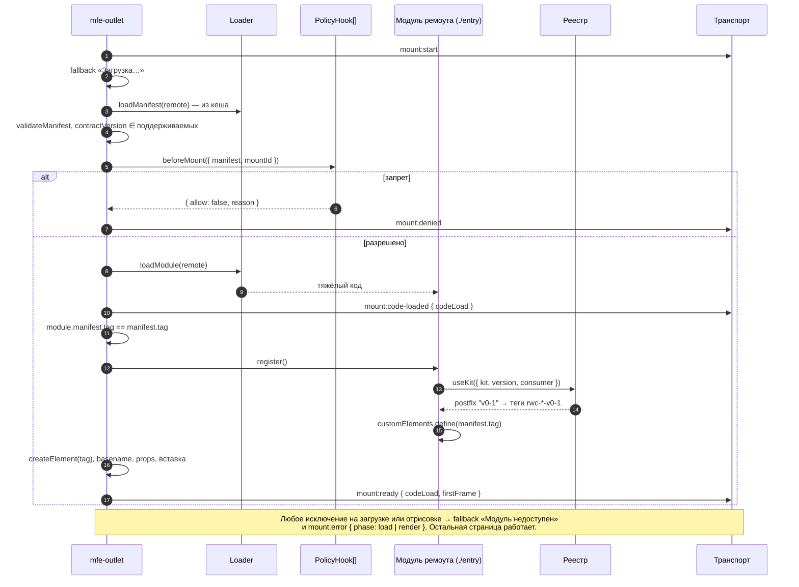
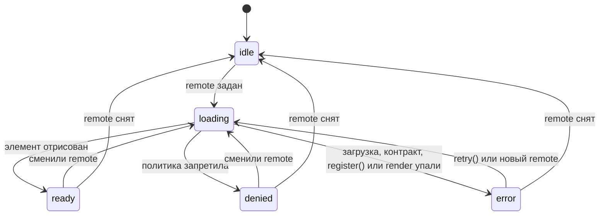
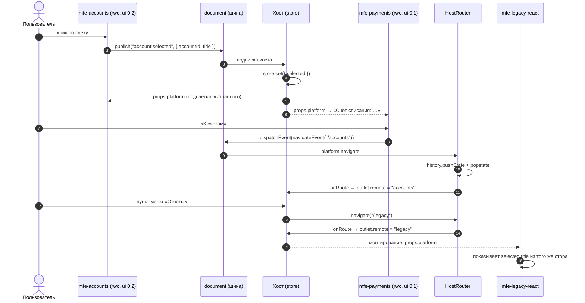
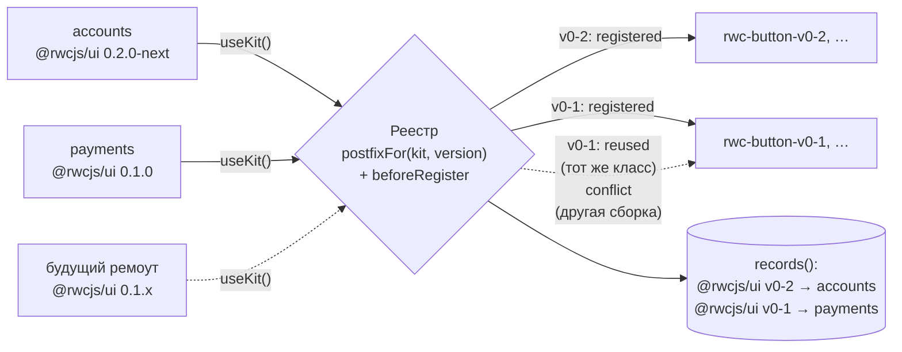
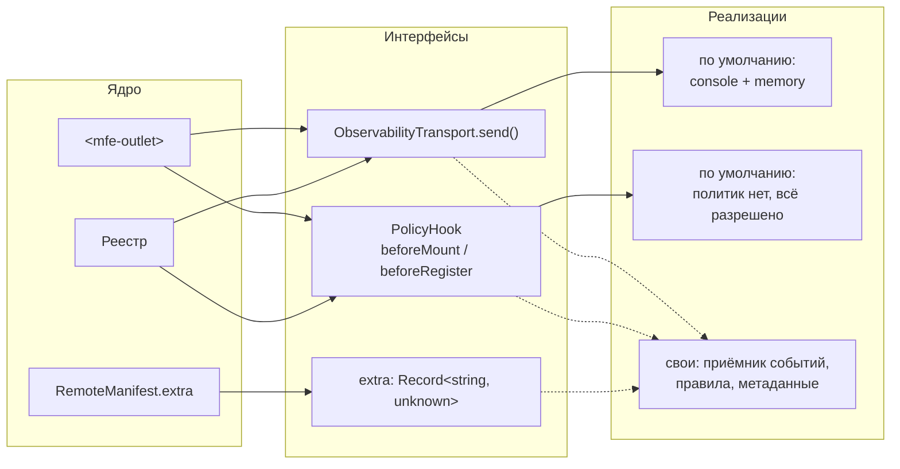
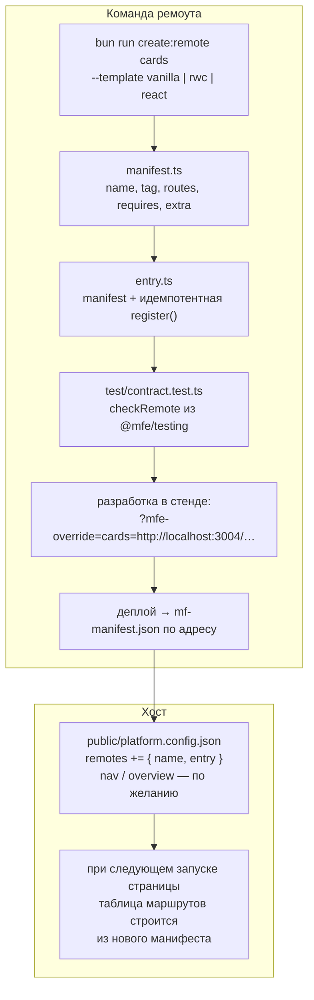

# Архитектура

[English](en/architecture.md) · Русский

Схемы — Mermaid: GitHub рисует их прямо в этом файле, а правятся они как текст рядом с кодом.
Подробности контракта — [contract.md](contract.md), инструменты для команд —
[development.md](development.md). Принципы и принятые решения — в
[разделе 9](#9-принципы-и-решения).

## 1. Пакеты и зависимости

Кто кого импортирует на этапе сборки. Стрелки идут только от внешних слоёв к ядру. CI
(`scripts/check-boundaries.ts`) проверяет два правила: ядро не знает UI-фреймворков и не знает
адаптеров и приложений.

## 2. Что работает на странице

Один документ, один хост, ремоуты с отдельных адресов. У каждого ремоута своя копия пакетов
ядра (Module Federation ничего не шарит), поэтому общие объекты живут не в модулях, а в
общих для всех копий местах: `document` для шины и `Symbol.for(...)` в `globalThis` для реестра.

Каналы между хостом и ремоутом, полностью:

| Направление | Канал | Что передаётся |
| --- | --- | --- |
| хост → ремоут | атрибут `basename` | префикс маршрутов ремоута |
| хост → ремоут | свойство `platform` | `PlatformState` целиком, при каждом изменении стора |
| ремоут → хост | `CustomEvent("platform:navigate")` | просьба перейти на чужой маршрут |
| ремоут → хост | обычная ссылка `<a href>` | переход через роутер хоста, без перезагрузки |
| ремоут → хост | шина, `store:patch` | просьба изменить общее состояние |
| ремоут ↔ ремоут | шина, свои темы (`account:selected`, …) | доменные события |
| ремоут → реестр | `useKit()` | регистрация кита, получение постфикса |
| ядро → наружу | `ObservabilityTransport` | события `mount:*`, `register:*` |

Прямых вызовов между ремоутами нет: ремоут не знает, кто ещё на странице.

## 3. Старт и первый переход

Манифесты грузятся сразу, они лёгкие и без фреймворка. Код ремоута грузится при первом
попадании на его маршрут.

Наведение или фокус на ссылке вызывает `prefetch(path)`: код ремоута загружается заранее, и
переход по ссылке берёт его из кеша загрузчика.

## 4. Монтирование ремоута в `<mfe-outlet>`

Состояния outlet (атрибут `state` и событие `mfe-outlet-state`):

Если `remote` меняется во время загрузки, ответ старой загрузки отбрасывается
(счётчик `generation`), поэтому быстрая навигация не монтирует не тот ремоут.

После ошибки fallback получает `retry`, а у outlet есть метод `retry()`: загрузка
повторяется с новым `mountId`. Загрузчик не кеширует упавшие загрузки, поэтому повтор
действительно идёт в сеть.

## 5. Сценарий: три демо-ремоута взаимодействуют

Страница обзора: accounts и payments рядом. Пользователь выбирает счёт в accounts, payments
показывает его как счёт списания, потом переход в legacy-отчёты.

## 6. Несколько версий UI-кита на одной странице

Реестр выбирает постфикс по линии совместимости версии, кит регистрирует теги сам.

`denied` или `conflict` превращается в исключение из `register()` — outlet показывает
fallback вместо полуработающего ремоута.

## 7. Точки расширения

Интерфейсы объявлены в `@mfe/contract`. Ядро везёт реализации по умолчанию; свои
подключаются параметрами, без форка.

## 8. Подключение нового ремоута

Код хоста и его сборка не меняются — только JSON-файл конфигурации.

Подробно о генераторе, тестах, подмене и панели отладки — [development.md](development.md).

## 9. Принципы и решения

**Граница ремоута — кастомный элемент.** Атрибуты и свойства на вход, `CustomEvent` на выход.
Прямых импортов между ремоутами нет. Бриджа под конкретный фреймворк нет: адаптер нужен
только тому, кто сам не кастомный элемент (React).

**Историю браузера пишет только хост.** Внутри своего `basename` ремоут навигирует сам, на
чужой маршрут — просит событием. Два роутера, пишущих в одну историю, — самый частый способ
сломать такую платформу.

**Имена тегов строит кит, а не платформа.** Реестр выбирает постфикс, ведёт учёт и применяет
политики; второго места, где склеивается имя тега, нет (это проверяет тест).

**Ядро не зависит от UI-фреймворков и не ходит в сеть.** Единственные запросы — за
конфигурацией и кодом ремоутов по адресам из конфигурации.

**Имя ремоута — JS-идентификатор.** Оно же имя контейнера Module Federation, а MF требует
идентификатор: `credit_cards`, не `credit-cards`. `validateManifest` и проверка
конфигурации отклоняют другие имена.

### Почему ремоуты ничего не шарят

Замер (`experiments/r4/measure.ts`): страница обзора с двумя ремоутами на rwc.

| Режим | host | accounts | payments | Всего |
| --- | ---: | ---: | ---: | ---: |
| Изоляция (по умолчанию) | 127.5 KB | 209.1 KB | 209.0 KB | **545.7 KB** |
| Общий синглтон `@rwcjs/core` (`MFE_SHARE_CORE=1`) | 129.2 KB | 196.0 KB | 217.8 KB | **543.0 KB** |

Общий core экономит 1.2% JS страницы, но привязывает все ремоуты к одному мажору фреймворка:
обновление снова становится общим релизом всех команд. Основной вес ремоута — рантайм Module
Federation (около 118 KB), а не фреймворк. `provide`/`inject` через границу ремоутов с
разными копиями core не работает, поэтому общее состояние раздаётся свойствами и событиями.

### Версии контракта

Хост поддерживает текущий мажор контракта и предыдущий (N и N−1). Ремоут на N−1 продолжает
монтироваться, ремоут на неизвестной версии получает `mount:error` и fallback. Поддержка N−1
снимается только в мажорном релизе `host-runtime`. Сейчас контракт один (`1`), окно
задаётся параметром `contractVersions` у `defineMfeOutlet`.

### Тема и локаль

Приходят в составе `PlatformState` свойством `platform`, отдельных атрибутов нет: один
канал, типизированный, и значение есть уже при первой отрисовке. Для CSS хост дополнительно
ставит `data-theme` на `<html>`.

### Подмена ремоута только на локальные адреса

`?mfe-override` грузит на страницу код по адресу из URL. Если разрешить любой адрес, ссылка
с параметром станет способом выполнить чужой код в контексте хоста. Поэтому по умолчанию
разрешены только `localhost`, `127.0.0.1` и `[::1]`: подмена полезна разработчику на его
машине и бесполезна атакующему. Хост может расширить список (например, адресами стенда).

Поэтому же подмена может и добавить ремоут, которого нет в конфигурации: новый ремоут
всё равно грузится только с локальной машины. Хост, которому это не нужно, передаёт
`allowNew: false`.

### Перехват ссылок

Хост перехватывает клики по `<a>` на `document`, после обработчиков ремоутов. Если роутер
ремоута уже обработал ссылку (`preventDefault`), хост её не трогает. Ссылки, которые должны
перезагрузить страницу (скачивание, другое приложение на том же домене), помечаются
`rel="external"` или `data-mfe-reload`.

### Shadow DOM у `<mfe-outlet>`

Нет. Изоляцию стилей выбирает сам ремоут на своём элементе (React-адаптер по умолчанию рендерит
в shadow root). Outlet в light DOM не мешает всплытию событий ремоута, а хост стилизует
свой fallback обычным CSS. Общие `customElements` и `document` shadow root у outlet всё равно
не изолировал бы.
