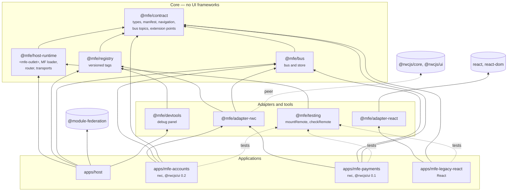
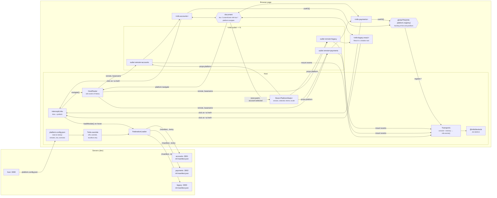
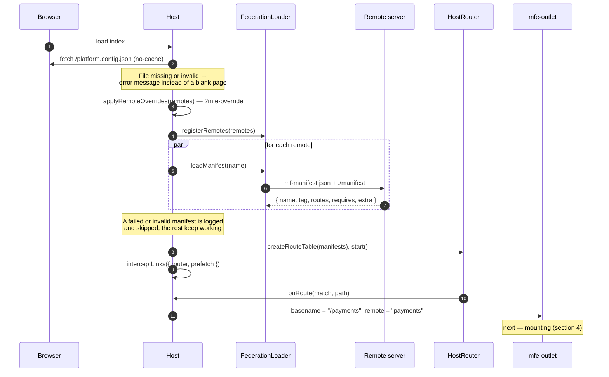
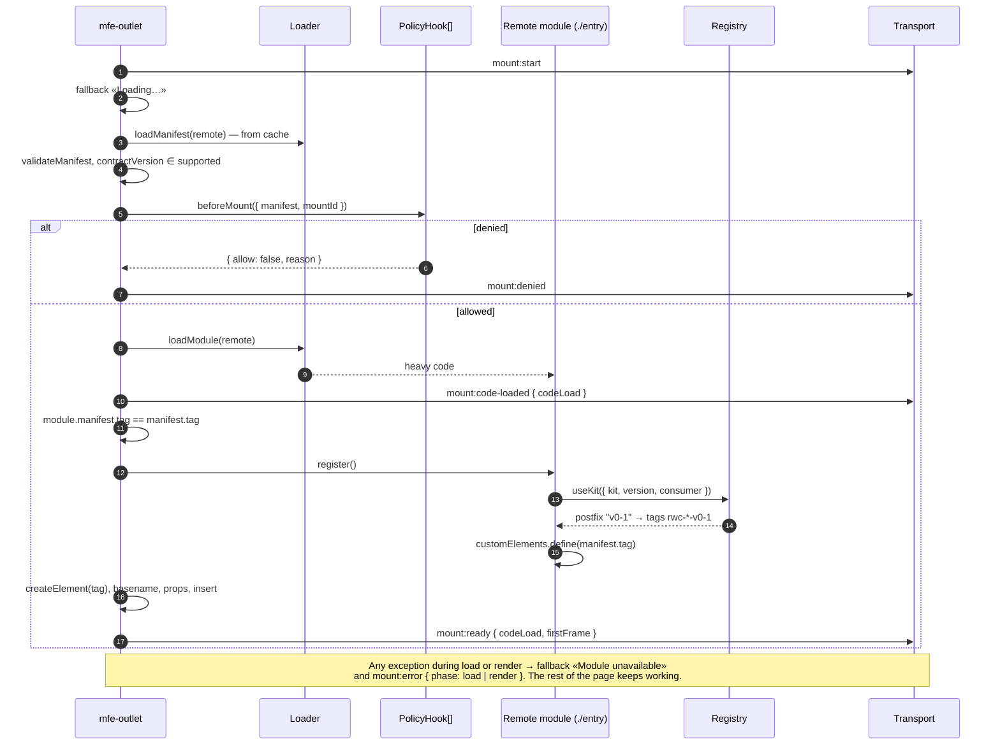
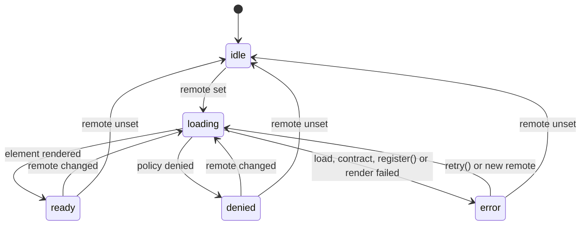
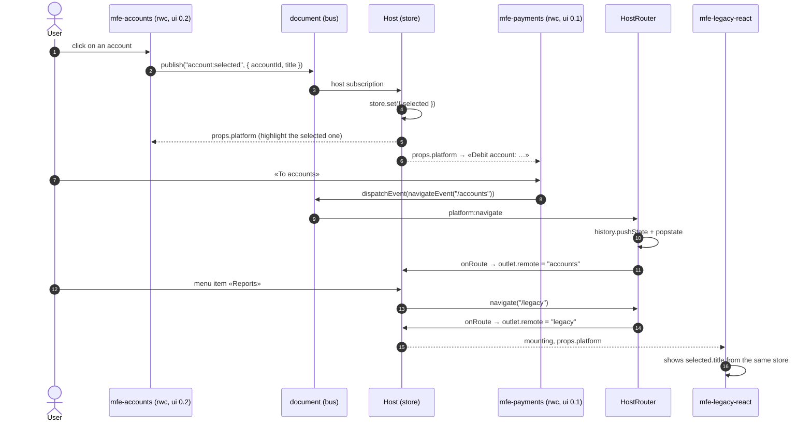
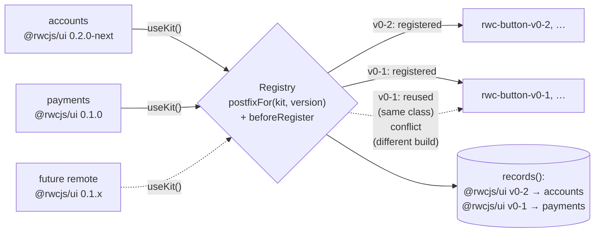
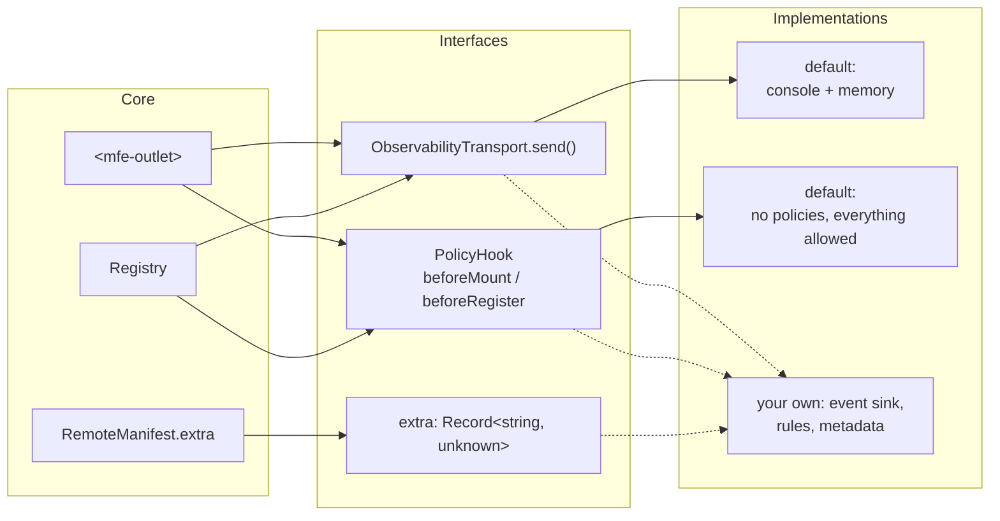
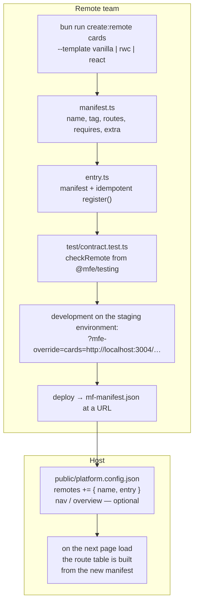

# Architecture

English · [Русский](../architecture.md)

The diagrams are Mermaid: GitHub renders them right in this file, and they are edited as text next to the code.
Contract details — [contract.md](contract.md), tools for teams —
[development.md](development.md). Principles and decisions taken — in
[section 9](#9-principles-and-decisions).

## 1. Packages and dependencies

Who imports whom at build time. Arrows go only from outer layers to the core. CI
(`scripts/check-boundaries.ts`) checks two rules: the core knows nothing about UI frameworks and nothing about
adapters and applications.

## 2. What runs on the page

One document, one host, remotes from separate URLs. Each remote has its own copy of the core
packages (Module Federation shares nothing), so shared objects live not in modules but in
places common to all copies: `document` for the bus and `Symbol.for(...)` in `globalThis` for the registry.

The channels between the host and a remote, in full:

| Direction | Channel | What is passed |
| --- | --- | --- |
| host → remote | `basename` attribute | the remote's route prefix |
| host → remote | `platform` property | the whole `PlatformState`, on every store change |
| remote → host | `CustomEvent("platform:navigate")` | a request to go to another remote's route |
| remote → host | plain `<a href>` link | navigation through the host router, without a reload |
| remote → host | bus, `store:patch` | a request to change shared state |
| remote ↔ remote | bus, custom topics (`account:selected`, …) | domain events |
| remote → registry | `useKit()` | kit registration, getting a postfix |
| core → outside | `ObservabilityTransport` | `mount:*`, `register:*` events |

There are no direct calls between remotes: a remote does not know who else is on the page.

## 3. Startup and first navigation

Manifests are loaded right away; they are lightweight and framework-free. A remote's code is loaded the first
time its route is hit.

Hovering or focusing a link calls `prefetch(path)`: the remote's code is loaded in advance, and
following the link takes it from the loader cache.

## 4. Mounting a remote in `<mfe-outlet>`

Outlet states (the `state` attribute and the `mfe-outlet-state` event):

If `remote` changes during loading, the response of the old load is discarded
(the `generation` counter), so fast navigation does not mount the wrong remote.

After an error the fallback receives `retry`, and the outlet has a `retry()` method: loading
is repeated with a new `mountId`. The loader does not cache failed loads, so the retry
really goes to the network.

## 5. Scenario: three demo remotes interact

The overview page: accounts and payments side by side. The user selects an account in accounts, payments
shows it as the debit account, then the user navigates to the legacy reports.

## 6. Several UI kit versions on one page

The registry picks a postfix by the version's compatibility line; the kit registers the tags itself.

`denied` or `conflict` becomes an exception from `register()` — the outlet shows a
fallback instead of a half-working remote.

## 7. Extension points

The interfaces are declared in `@mfe/contract`. The core ships default implementations; your own
are plugged in through parameters, without a fork.

## 8. Adding a new remote

The host code and its build do not change — only the JSON configuration file.

Details on the generator, tests, override and the debug panel — [development.md](development.md).

## 9. Principles and decisions

**The remote boundary is a custom element.** Attributes and properties in, `CustomEvent` out.
There are no direct imports between remotes. There is no bridge for a specific framework: an adapter is needed
only by something that is not a custom element itself (React).

**Only the host writes browser history.** Within its own `basename` a remote navigates by itself; for
another remote's route it asks with an event. Two routers writing to one history are the most common way
to break a platform like this.

**Tag names are built by the kit, not by the platform.** The registry picks the postfix, keeps track and applies
policies; there is no second place where a tag name is assembled (a test checks this).

**The core does not depend on UI frameworks and does not go to the network.** The only requests are for
the configuration and for remote code at the URLs from the configuration.

**A remote name is a JS identifier.** It is also the Module Federation container name, and MF requires
an identifier: `credit_cards`, not `credit-cards`. `validateManifest` and the configuration
check reject other names.

### Why remotes share nothing

Measurement (`experiments/r4/measure.ts`): the overview page with two rwc remotes.

| Mode | host | accounts | payments | Total |
| --- | ---: | ---: | ---: | ---: |
| Isolation (default) | 127.5 KB | 209.1 KB | 209.0 KB | **545.7 KB** |
| Shared `@rwcjs/core` singleton (`MFE_SHARE_CORE=1`) | 129.2 KB | 196.0 KB | 217.8 KB | **543.0 KB** |

A shared core saves 1.2% of the page's JS, but ties all remotes to one framework major version:
an upgrade becomes a joint release of all teams again. Most of a remote's weight is the Module
Federation runtime (about 118 KB), not the framework. `provide`/`inject` across the boundary of remotes with
different copies of core does not work, so shared state is distributed through properties and events.

### Contract versions

The host supports the current contract major version and the previous one (N and N−1). A remote on N−1 keeps
mounting; a remote on an unknown version gets `mount:error` and a fallback. Support for N−1
is dropped only in a major release of `host-runtime`. Right now there is one contract (`1`); the window
is set by the `contractVersions` parameter of `defineMfeOutlet`.

### Theme and locale

They come as part of `PlatformState` in the `platform` property; there are no separate attributes: one
channel, typed, and the value is already there at the first render. For CSS the host additionally
sets `data-theme` on `<html>`.

### Remote override only for local URLs

`?mfe-override` loads code onto the page from a URL taken from the page URL. If any URL were allowed, a link
with the parameter would become a way to run someone else's code in the host's context. So by default
only `localhost`, `127.0.0.1` and `[::1]` are allowed: an override is useful to a developer on their
machine and useless to an attacker. The host can extend the list (for example, with staging environment URLs).

For the same reason an override may also add a remote that is not in the configuration: the new remote
still loads only from the local machine. A host that does not need this passes `allowNew: false`.

### Link interception

The host intercepts clicks on `<a>` on `document`, after the remotes' handlers. If a remote's router
has already handled the link (`preventDefault`), the host leaves it alone. Links that must
reload the page (a download, another application on the same domain) are marked with
`rel="external"` or `data-mfe-reload`.

### Shadow DOM on `<mfe-outlet>`

No. The remote chooses style isolation itself on its own element (the React adapter renders
into a shadow root by default). An outlet in light DOM does not interfere with the bubbling of the remote's events, and the host styles
its fallback with plain CSS. A shadow root on the outlet would not isolate the shared `customElements` and `document`
anyway.
